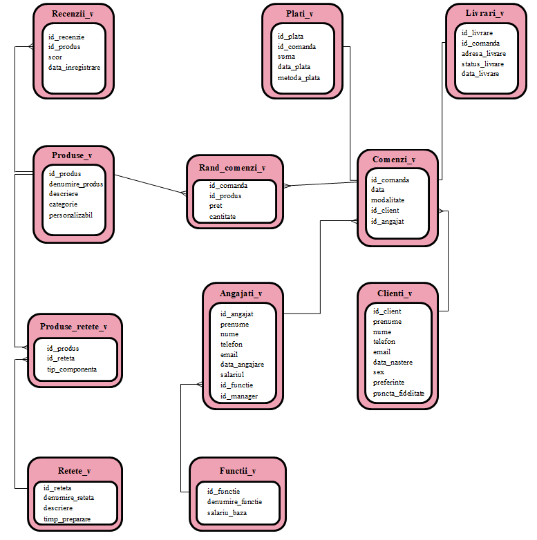

# Overview
This is a comprehensive, normalized relational database system designed to manage daily operations, inventory, and sales analytics for a pastry shop business.

# Used Tools
- **Oracle SQL Developer:** The primary IDE used for database administration, schema modeling, and developing PL/SQL packages.
- **Visual Studio Code:** The primary code editor used for writing, debugging, and managing the project codebase.
- **Git & GitHub:** Used for version control, tracking project iterations, and hosting the remote repository.

# The Goal
To architect a Third Normal Form (3NF) relational database that **automates business** logic via PL/SQL and delivers actionable business intelligence through advanced analytical SQL queries.

# Project Architecture
This repository is divided into two parts: the foundational schema definition (standard SQL) and advanced business logic implementation (PL/SQL).

# Database Schema

These are the main roles of the tables we will be using:
- **Clients** (Clienti_v): Stores customer demographics, contact details, preferences, and accumulated loyalty points.   
- Employees (Angajati_v) & Roles (Functii_v): Manages staff records, hire dates, and maps employees to their respective job roles and base salaries. This table includes an id_manager attribute, allowing for recursive queries to model organizational hierarchies.   
- **Products** (Produse_v) & Reviews (Recenzii_v): Catalogs inventory, product categories, and customization options. It now connects to a reviews entity to track product-specific customer satisfaction scores and feedback dates.   
- **Orders** (Comenzi_v) & **Order Lines** (Rand_comenzi_v): Captures core transactional data, mapping multiple products, prices, and quantities to specific customer orders and processing employees.   
- **Payments** (Plati_v): Tracks financial transactions, linking payment amounts, dates, and methods directly to their corresponding orders.   
- **Deliveries** (Livrari_v): Manages order logistics by storing delivery addresses, current statuses, and delivery dates.   
- **Recipes** (Retete_v) & **Recipe Components** (Produse_retete_v): Details preparation times and maps specific recipes to their final products.

# Database Setup & Deployment
To deploy this database locally, execute the scripts in the [schema/](schema) directory in the following order:
- tables_creation.sql: Defines the base 3NF relational structures.   
- alter_tables.sql: Applies structural modifications and schema updates.   
- constraints.sql: Enforces primary keys, foreign keys, and data integrity rules.   
- data_insertion.sql: Populates the tables with sample transactional records for testing.